# 核心数据模型草案

## 1. 数据约定

- 数据库使用 PostgreSQL。
- 内部主键使用大整数；对外资源使用不可枚举的公共 ID。
- 现金金额统一使用人民币分整数，积分使用大整数，禁止浮点数。
- 时间统一保存，客户端按照用户时区展示；业务默认时区为 Asia/Shanghai。
- 账务、积分、库存和审计流水只追加，不物理删除。
- 商品、订单项、任务领取记录保存业务快照，避免配置变化影响历史数据。
- 关键表包含 `created_at`、`updated_at`，需要并发控制的表增加版本字段。

## 2. 用户与权限

### `users`

用户基础资料、状态、手机号验证时间和注销状态。

### `user_identities`

统一关联手机号、微信小程序 OpenID、公众号 OpenID 和 UnionID。建议唯一约束：`provider + provider_user_id`。

### `user_devices`

记录设备、客户端类型、版本和推送标识，用于登录安全和消息推送。

### `user_sessions`

记录可轮换 Refresh Token 的摘要、设备、签发时间、过期时间、撤销时间与撤销原因。Access Token 不保存明文。

### `account_cancellation_requests`

账号注销申请、资格检查快照、冷静期截止时间、撤销/执行状态和审计信息。注销执行前必须重新校验未结业务与资产。

### `legal_document_versions`、`user_consents`

用户协议、隐私政策和专项规则的版本、适用端、生效时间与内容摘要，以及用户同意/撤回的文档版本、客户端、时间、IP 摘要和请求 ID。同意记录只追加，文档历史版本不可覆盖。

### `privacy_requests`

用户查询、复制、更正、删除和撤回授权请求，保存类型、范围、身份验证、阻断项、状态、处理结果、导出文件到期时间和审计信息。账号注销继续使用独立状态机。

### `data_retention_rules`、`data_deletion_jobs`、`legal_holds`

数据类别、起算事件、默认期限、到期动作和规则版本；删除任务的扫描/删除/失败计数与重试；争议或法定冻结的业务对象、原因、批准和解除记录。删除任务覆盖数据库、对象存储、搜索、缓存和备份删除重放清单。

### `user_addresses`

用户收货地址；收货人、电话和详细门牌使用应用层加密，列表仅允许本人访问。首个地址自动成为默认地址，删除默认地址时自动提升另一条地址。订单必须保存地址快照，不能只引用当前地址。

### `user_asset_accounts`、`user_milestones`

用户积分、余额和优惠券的并发汇总账户，以及资料完善等一次性里程碑及奖励投递状态。第 12 批账本落地后，所有汇总字段只能由不可变流水事务更新；当前汇总账户同时作为注销资格的资产事实来源。

### `admin_users`、`roles`、`permissions`、`admin_user_role`、`permission_role`

后台账号与普通用户身份隔离，RBAC 保存角色、权限和后台账号绑定关系。

### `approval_requests`、`approval_actions`

现金退款、人工积分调整、批量发券等高风险操作的申请、二次审核和执行结果；申请人与审核人不能相同。

### `system_settings`、`system_setting_versions`

类型化全局配置、草稿、已发布版本、生效时间和历史快照，包括三端登录、分享、支付和通知能力版本。积分、优惠券、售后原因等复杂领域规则仍使用各自业务表。

## 3. 任务

### `reward_budget_pools`、`reward_budget_transactions`

平台积分发行额度、指定优惠券模板数量和余额现金预算池，以及锁定、追加、释放、追回和人工调整流水。余额现金预算以人民币分保存，流水不可删除。

### `task_publishers`

任务发布主体。首版仅保存已启用后台账号对应的平台管理员发布者，并可关联其前端用户身份；预留 `platform_admin/user/organization` 主体类型，但 `user` 和 `organization` 类型首版禁止启用。外部主体不是后台角色。

### `task_publisher_applications`、`task_publisher_qualifications`、`task_publisher_limits`

未来外部发布者的申请阶段、个人/机构认证结论、资质类型与有效期，以及允许类别、在线任务数、参与人数、单笔奖励和预算额度。首发只预留迁移设计，不提供普通用户申请和写接口。

### `publisher_funding_accounts`、`publisher_funding_transactions`

未来非平台发布者预付奖励资金的可用、锁定、争议冻结和待退金额，以及充值、锁定、释放、发奖、退款和调整流水。该账户与用户商城钱包、平台预算池分离；正式建设前需要支付、财务、税务和法务评审。

### `task_publish_requests`

从后台或用户端提交的发布/重大修改申请、校验摘要、风险等级、审批状态、申请人、审批人、驳回原因和时间。发布者不能审批自己的申请。

第 11 批已先落地专用 `task_publish_approvals`：仅承接高额余额奖励首次发布复核，按任务版本唯一，保存命中规则、门槛快照、申请人、非同人财务复核人、意见和幂等摘要。后续重大修改审批再扩展为通用发布申请模型。

### `task_tags`、`task_tag_relations`

任务搜索与筛选标签及关联关系。标签代码稳定、展示名可配置；未发布任务不进入公开搜索索引。

### `task_placement_requests`、`task_placements`

发布者提交的推荐位申请，以及后台批准的栏目、置顶顺序、开始/结束时间和审批记录。发布者不能直接写置顶结果或审批自己的申请。

### `tasks`

平台管理员发布的任务、发布主体、创建渠道、公开/定向保密可见性、标题、业务分类、周期类型、参与方式、说明、最大成功奖励次数、当前占位/成功/历史领取计数、完成期限、资格、预算、提交次数、核验方式、审核/申诉期限、材料字段、附件限制、领取和完成时间、状态及版本。创建渠道支持管理后台和用户端任务发布中心；普通用户与第三方主体首版禁止发布。

### `task_versions`、`task_change_requests`

不可变任务版本、完整规则快照、字段差异、普通/重大分类、发布状态和审批记录。服务端按字段差异决定变更类型；回滚复制历史版本形成新版本。

### `task_status_logs`

暂停、恢复、关闭、紧急处置和归档动作、原因、已有用户处理策略、操作渠道、操作人和时间，只追加不覆盖。

第 11 批物理表名为 `task_status_changes`，并同时记录首次发布申请与正式发布动作；每个状态动作使用唯一幂等摘要。

### `task_risk_assessments`、`task_risk_cases`

发布、重大修改、领取或提交产生的规则命中、风险等级、证据摘要、自动建议、人工结论、奖励冻结和处理期限。自动建议与最终人工结论分别保存。

### `task_reports`、`task_risk_actions`、`task_publisher_penalties`

用户举报原因和证据、风险处置动作、发布者警告/暂停/撤权/禁用、申诉和平台误判补偿关联。处置记录只追加。

### `task_submission_fingerprints`、`allowed_external_domains`

任务材料的文件/规范化文本/图片相似度摘要，以及经后台批准的外部域名白名单。摘要用于风险判断，不替代原材料权限控制。

### `task_rewards`

任务的积分、优惠券和余额奖励配置，一个任务可包含多种奖励；余额使用人民币分。

### `task_reward_budgets`、`task_reward_reservations`

每个任务奖励组件绑定的平台预算池、活动总奖励次数、单周期上限、锁定值、已预留、已发放、已释放和已回收值；用户领取或系统自动加入时生成个人奖励预留，随后转发放或释放。

第 13 批已实现 `task_reward_reservations`，每个用户任务与奖励序号唯一；领取时按任务预算主键稳定顺序加锁，所有组件预留与用户任务创建同事务提交。

### `task_claims`

用户主动领取或系统自动加入的任务记录、加入来源、周期标识、占位状态、任务快照、状态、有效进度时间、实际完成期限、取消次数、已提交次数、申诉次数和奖励状态。唯一约束按任务周期规则限制用户重复参与。

第 13 批同时实现 `task_claim_status_changes` 只追加状态流水；取消和系统到期只把个人预留释放回任务预算，不回退历史领取记录，当前周期唯一记录继续保留。

### `task_submissions`

提交内容、附件、提交序号、状态、撤回时间、审核开始时间、审核截止时间和提交时间。撤回记录不删除。

第 14 批已实现提交内容与附件 ID 快照、提交序号唯一约束、审核逾期提醒时间和撤回留痕；附件在提交事务前校验归属、用途、安全扫描、分类数量和大小。

### `task_reviews`

每次审核动作、审核人、结果、原因和时间。审核通过事件使用 `task_claim_id` 保证奖励幂等。

第 14 批已实现人工审核追加记录；开始审核后不允许用户撤回，驳回原因和说明必填，通过后只改变任务结论并触发独立奖励投递。

### `task_appeals`

最终驳回后的申诉理由、补充证据、原审核人、申诉审核人、处理结果和时间；同一领取记录默认最多一次，申诉审核人与原审核人不同。

### `task_reward_deliveries`

每种奖励的幂等键、奖励快照、投递状态、重试次数、成功时间、失败原因和人工补偿记录。奖励失败不改变任务审核通过结果。

第 14 批已实现每个奖励预留唯一投递、积分/余额/优惠券账本幂等入账、预算结算、失败退避和人工重试幂等记录；另以 `task_verification_events` 保存可信服务端自动核验事件。

## 4. 成长与社区

### `check_ins`

签到日期、用户和连续签到信息。唯一约束：`user_id + check_in_date`。

### `referrals`

邀请人、新用户、绑定时间、首次有效任务里程碑、首笔现金订单达标状态、各时间和奖励事件。邀请人只能看到脱敏的阶段进度，不能读取新人的任务材料和订单内容。

### `community_posts`

帖子内容、作者、状态、审核信息、发布时间和删除原因。

### `community_post_versions`、`community_attachments`

帖子每次编辑版本、审核状态，以及图片和视频附件。已发布帖子修改后，新版本通过前保留旧版本展示。

### `community_comments`

帖子、作者、父评论、内容、状态和审核信息。

### `content_reports`、`moderation_actions`

举报、审核、隐藏、删除和违规处理记录。

### `content_appeals`、`user_restrictions`

内容处理申诉，以及限制发帖、限制评论、禁言和账号限制的时间范围及原因。

## 5. 积分

### `point_accounts`

用户可用、冻结和欠额积分汇总及并发版本。欠额独立保存为非负数；汇总必须能由批次、流水和欠额记录重新计算。

### `point_rules`

来源代码、奖励数额、有效期天数、次数上限、生效期、审核要求、撤销规则和规则版本。

### `point_reward_events`

来源业务事件和幂等键。唯一约束：`event_key`。

### `point_lots`

积分批次：用户、来源、发放量、剩余量、冻结量、过期时间、规则版本和状态。

第 12 批物理表名为 `point_batches`，并以 `event_key_hash` 保证来源事件幂等；消费分配物理表为 `point_batch_allocations`。

### `point_transactions`

积分总流水：发放、冻结、解冻、消费、退款、过期、撤销和人工调整。

### `point_allocations`

消费或退款与具体积分批次的分配关系，用于最早过期优先、退款溯源和对账。

### `point_debts`、`point_debt_allocations`

违规撤销不足形成的欠额、原奖励来源、剩余欠额、状态，以及后续新积分偿还或人工减免的分配明细。欠额不表现为负可用余额。

存在欠额时禁止积分消费。所有新增积分先形成来源流水，再按最早欠额优先偿还；超过欠额的部分进入正常积分批次。

## 5.1 用户钱包

### `wallet_accounts`

用户币种、可用余额、冻结余额和并发版本。余额单位为人民币分，汇总必须可由流水重新计算。

第 12 批复用 `user_asset_accounts` 作为积分、钱包与可用券数量的并发汇总，真实账务依据分别是积分批次/流水、钱包流水和券实例/流水。

### `wallet_transactions`

余额发放、冻结、解冻、消费、退款和人工调整流水，包含业务对象和幂等键；只追加不删除。

### `wallet_allocations`

余额交易与任务奖励、订单、退款等业务来源的分配关系，为退款和审计提供依据。

### `withdrawals`

提现申请金额、手续费、实际到账、冻结流水、渠道、收款身份、审核、第三方转账号、状态和失败原因。

第 12 批物理表名为 `wallet_withdrawals`：手续费率以百万分比快照，申请时全额从可用转冻结；拒绝解冻，批准进入 `processing`，真实微信转账在第 19 批接入。

## 6. 商品与库存

### `product_categories`

商品分类和排序。

### `products`

SPU 基础信息、详情、状态和展示配置。

### `product_skus`

SKU 规格、编码、图片、重量、状态、限购规则和唯一履约类型 `logistics/no_logistics/virtual_delivery`。

### `sku_purchase_options`

SKU 购买方案：`points`、`cash`、`mixed`，以及现金金额、积分数量、启用状态和有效期。唯一约束：`sku_id + purchase_mode`。

三个首发端读取相同购买方案，不按渠道存储价格。

### `inventories`

SKU 的实际、预占、可售库存汇总和低库存阈值；默认阈值 10 件并允许 SKU 覆盖。

### `inventory_reservations`

待支付订单的 SKU 预占数量、到期时间、状态和释放/扣减时间。订单项与 SKU 唯一，默认 15 分钟到期。

### `inventory_transactions`

预占、释放、扣减、退货入库和盘点流水，包含业务类型和业务 ID 幂等约束。

### `shipping_templates`、`shipping_template_regions`、`shipping_free_rules`

固定、按件或按重量的运费模板，省市区配送范围、偏远附加费，以及指定商品、满商品现金金额和满件包邮规则。模板使用不可变版本供订单保存快照。

## 7. 优惠券

### `coupon_templates`

优惠券名称、现金权益、积分权益、现金/积分使用门槛、适用范围类型、发放方式、每人上限、有效期规则、返券宽限天数、发行量和状态。

### `coupon_scopes`

优惠券适用的分类、商品或 SKU。全部商品券不需要范围明细。

### `user_coupons`

用户持有券、有效期、状态、来源和关联订单。一个订单最多关联一张使用券。

### `coupon_allocations`

优惠券现金和积分权益在订单项上的分摊快照。

### `coupon_transactions`

领取、锁定、使用、释放、返还和过期流水，保证返券幂等。

第 12 批已实现模板、用户券及只追加券流水；用户券保存发行时完整权益和有效期快照，模板后续修改不改变已发行券。

### `asset_adjustment_requests`

后台积分、余额和优惠券发放申请。保存操作、数量、原因、申请人、复核人、幂等摘要和应用时间；余额超过 200 元、积分超过 1000 分、批量发券超过 1000 张或任意清零必须由不同管理员复核。

## 8. 购物车与订单

### `carts`、`cart_items`

用户购物车。购物车价格只用于展示，创建订单时必须重新校验。

### `orders`

订单号、结算批次、用户、渠道、单一交付类型、状态、商品现金总额、积分总额、现金运费、优惠、唯一现金支付方式、余额/外部渠道实付、实际积分、地址快照和时效快照。余额与微信实付不能同时大于零。

### `order_batches`

同一次结算请求及其拆分订单集合。不同交付类型生成不同订单；批次只用于聚合展示和追踪，不覆盖子订单独立支付、履约和售后状态。

### `order_items`

商品与 SKU 快照、购买方式、数量、现金/积分原价、优惠分摊、余额/外部渠道/积分实际支付及各来源累计已退款值。

### `order_status_logs`

订单状态变化、操作来源、操作人和原因。

### `fulfillments`、`fulfillment_items`

记录实体物流、无需物流或虚拟交付，以及每次履约涉及的订单项和数量；一个订单仅有一种交付类型，但同类型商品仍支持分批履约。

### `fulfillment_tracking_events`

物流轨迹标准状态、描述、发生时间、地点、查询渠道和原始状态摘要；按承运商、物流单号和事件标识去重。

## 9. 支付与退款

### `payments`

支付单、渠道、场景、小程序/微信内 H5/微信外 H5、现金金额、第三方交易号和状态。

### `payment_callbacks`

回调摘要、验签结果、处理状态和去重键。敏感原文必须脱敏或加密保存。

### `refunds`

退款单、类型、原因、状态、申请人与审核人、应退现金和积分。

### `refund_items`

订单项、退款数量、现金、积分和优惠分摊快照。

### `refund_components`

现金退款、积分退回、优惠券返还、退货运费承担等子处理及重试状态。

### `return_shipments`

是否需要物流、退货物流、付款凭证、责任方、用户垫付金额、最终承担金额、补偿金额、提交截止时间和处理状态。

### `after_sale_reasons`

后台可配置的退货原因、默认责任方、售后类型、原运费策略、退货运费承担、凭证要求和补偿上限。实际退货不退原运费；未完成交付且无需退货的整单退款可以退回。

### `exchanges`、`exchange_shipments`

同一 SKU 换货申请、数量、原因、责任方、寄回期限、换出库存和寄回/补发物流。换货数量受订单项剩余可换数量约束，不产生跨 SKU 差价。

## 10. 通知、文件和审计

### `files`

文件所有者、存储路径、类型、大小、访问级别和安全检查状态。

### `notifications`、`notification_deliveries`

站内消息及短信、微信、推送等渠道发送记录。

### `notification_preferences`

用户必要/可选消息渠道、营销订阅、免打扰开始和结束时间。

### `notification_templates`、`notification_template_versions`

通知场景、渠道、变量白名单、草稿、发布版本和历史快照。

### `operation_logs`

后台操作人、动作、对象、变更摘要、IP 和请求 ID。

### `idempotency_keys`

关键写接口幂等键、请求摘要、处理结果和过期时间。

## 11. 高层关系

```mermaid
erDiagram
    USERS ||--o{ USER_IDENTITIES : has
    USERS ||--o{ TASK_CLAIMS : claims
    TASK_PUBLISHERS ||--o{ TASKS : publishes
    TASKS ||--o{ TASK_VERSIONS : versions
    TASKS ||--o{ TASK_CHANGE_REQUESTS : changes
    TASKS ||--o{ TASK_STATUS_LOGS : status_history
    TASKS ||--o{ TASK_RISK_ASSESSMENTS : assessed
    TASKS ||--o{ TASK_REPORTS : reported
    TASKS ||--o{ TASK_RISK_CASES : investigated
    TASKS ||--o{ TASK_PUBLISH_REQUESTS : requests_publish
    TASKS ||--o{ TASK_TAG_RELATIONS : tagged
    TASK_TAGS ||--o{ TASK_TAG_RELATIONS : classifies
    TASKS ||--o{ TASK_PLACEMENT_REQUESTS : requests_placement
    TASKS ||--o{ TASK_PLACEMENTS : placed_in
    REWARD_BUDGET_POOLS ||--o{ TASK_REWARD_BUDGETS : funds
    TASKS ||--o{ TASK_REWARD_BUDGETS : budgets
    TASKS ||--o{ TASK_CLAIMS : contains
    TASK_CLAIMS ||--o{ TASK_REWARD_RESERVATIONS : reserves
    TASK_REWARD_BUDGETS ||--o{ TASK_REWARD_RESERVATIONS : allocates
    TASK_CLAIMS ||--o{ TASK_SUBMISSIONS : submits
    TASK_CLAIMS ||--o{ TASK_APPEALS : appeals
    TASK_CLAIMS ||--o{ TASK_REWARD_DELIVERIES : rewards
    USERS ||--o{ POINT_LOTS : owns
    USERS ||--|| POINT_ACCOUNTS : summarizes
    USERS ||--o{ POINT_DEBTS : owes
    POINT_RULES ||--o{ POINT_LOTS : creates
    POINT_LOTS ||--o{ POINT_ALLOCATIONS : allocated
    POINT_DEBTS ||--o{ POINT_DEBT_ALLOCATIONS : repaid_by
    PRODUCTS ||--o{ PRODUCT_SKUS : has
    PRODUCT_SKUS ||--o{ SKU_PURCHASE_OPTIONS : offers
    PRODUCT_SKUS ||--|| INVENTORIES : stocks
    PRODUCT_SKUS ||--o{ INVENTORY_RESERVATIONS : reserves
    SHIPPING_TEMPLATES ||--o{ PRODUCT_SKUS : prices_delivery
    SHIPPING_TEMPLATES ||--o{ SHIPPING_TEMPLATE_REGIONS : covers
    USERS ||--o{ ORDERS : places
    USERS ||--o{ ORDER_BATCHES : checks_out
    ORDER_BATCHES ||--o{ ORDERS : splits_into
    ORDERS ||--o{ ORDER_ITEMS : contains
    ORDER_ITEMS ||--o| INVENTORY_RESERVATIONS : reserves
    ORDERS ||--o{ PAYMENTS : pays
    ORDERS ||--o{ REFUNDS : refunds
    ORDER_ITEMS ||--o{ EXCHANGES : exchanges
    ORDERS ||--o{ FULFILLMENTS : fulfills
    FULFILLMENTS ||--o{ FULFILLMENT_TRACKING_EVENTS : tracks
    REFUNDS ||--o{ REFUND_ITEMS : contains
    COUPON_TEMPLATES ||--o{ USER_COUPONS : issues
    USER_COUPONS o|--o| ORDERS : used_by
    COMMUNITY_POSTS ||--o{ COMMUNITY_COMMENTS : has
```

## 12. 实施顺序

1. 用户、身份、角色和权限。
2. 任务、领取、提交和审核。
3. 积分规则、批次、流水和分配。
4. 社区、签到和推荐事件。
5. 商品、SKU、购买方案和库存。
6. 优惠券、购物车和订单。
7. 支付、退款、退货和对账。
8. 通知、文件、审计和幂等基础设施。

每一组表在创建 Laravel 迁移前，需要进一步补齐字段字典、索引和删除策略。
